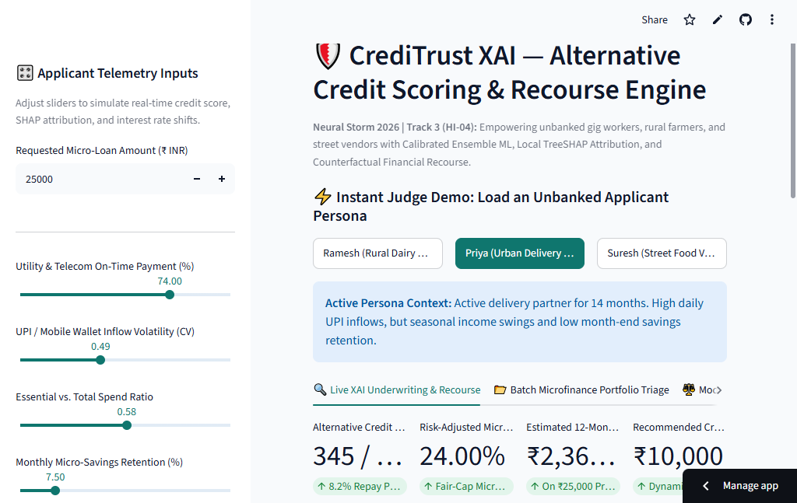
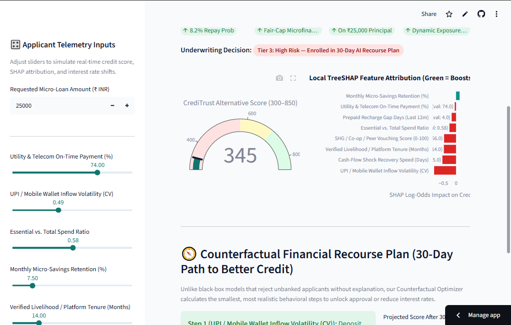

# 🛡️ CrediTrust XAI — Alternative Credit Scoring & Counterfactual Recourse Engine

> **Neural Storm 2026 Submission**  
> **Track 3:** Human Impact — Healthcare, Education & Social Good  
> **Problem Statement ID:** `HI-04` (Alternative Credit Scoring for the Unbanked)  
> **Live Deployment Prototype:** [🔗 Launch CrediTrust XAI on Streamlit Cloud](https://creditrust-xai.streamlit.app)

---

## 👥 Team Information
- **Team Name:** Neural Architects (Solo Entry)
- **Developer:** Prem (`@mynameisprem-pj`)
- **GitHub Repository:** `https://github.com/mynameisprem-pj/creditrust-xai`

---

## 🌍 1. Problem Description
Over **1.4 billion adults globally**—including street vendors, smallholder rural farmers, and platform gig workers—remain "credit invisible." Traditional credit bureaus (such as CIBIL, FICO, or Experian) rely strictly on formal credit card histories, collateralized bank loans, and salaried tax filings. 

This creates two systemic failures:
1. **Unfair Financial Exclusion:** Creditworthy informal workers who pay electricity bills on time, run active digital wallets (UPI), and hold strong Self-Help Group (SHG) peer trust are automatically rejected by legacy banking algorithms, forcing them toward predatory informal moneylenders charging 60%–120% APR.
2. **The "Black-Box Rejection" Trap:** Even when alternative ML models are deployed, they typically act as opaque black boxes—outputting a binary *Rejected* label without auditing for demographic bias (Rural vs. Urban) or telling the borrower *how* to become creditworthy.

---

## 💡 2. Proposed Solution: CrediTrust XAI
**CrediTrust XAI** is an end-to-end, explainable microfinance underwriting and borrower empowerment platform built in Python. Instead of relying on formal credit bureau records, it evaluates **8 alternative financial telemetry signals** and pairs predictions with **Local TreeSHAP Attribution**, an **Automated 30-Day Counterfactual Recourse Optimizer**, and an **Algorithmic Fairness Audit**.

### Key Innovations
1. **Calibrated Stacking Ensemble Architecture:** Combines gradient-boosted decision trees (`XGBoost` + `LightGBM`) and `RandomForest` with a `LogisticRegression` meta-learner to capture non-linear risk interactions (e.g., how strong micro-savings retention offsets seasonal gig-income volatility).
2. **Real-Time Local TreeSHAP Explainability:** Every credit score (300–850) is decomposed into exact log-odds feature contributions so loan officers and borrowers can see *why* a decision was reached.
3. **Counterfactual Financial Recourse Engine:** Rather than leaving high-risk applicants at a dead end, a greedy constrained optimization algorithm computes the **smallest, realistic 30-day behavioral changes** (e.g., reducing prepaid recharge gap days or boosting utility bill timeliness) required to cross the approval threshold and lower their micro-loan APR.
4. **Algorithmic Fairness & 80% Rule Compliance:** Built-in auditing verifies **Disparate Impact Ratio** and **Equal Opportunity Difference** across Rural vs. Urban cohorts to prevent location-based algorithmic bias.
5. **Batch SHG / NGO Portfolio Triage:** Allows microfinance field officers to upload CSV cohorts and underwrite hundreds of village applicants in milliseconds.

---

## 🧠 3. Technical Approach & Alternative Telemetry Features

```
┌─────────────────────────────────────────────────────────────────────────┐
│                8 Alternative Financial Telemetry Signals                │
│  • Utility & Telecom Timeliness (%)   • UPI / Wallet Inflow Volatility  │
│  • Essential vs. Total Spend Ratio    • Micro-Savings Retention (%)     │
│  • Verified Livelihood Tenure (Mo)    • SHG / Co-op Peer Trust (0-100)  │
│  • Prepaid SIM Recharge Gap Days      • Cash-Flow Shock Recovery (Days) │
└───────────────────────────────────┬─────────────────────────────────────┘
                                    ▼
┌─────────────────────────────────────────────────────────────────────────┐
│             5-Fold Stacking Ensemble Classifier (Scikit-Learn)          │
│     [ XGBoost ]  +  [ LightGBM ]  +  [ Random Forest ]                  │
│                           │                                             │
│                           ▼                                             │
│             [ Logistic Regression Meta-Learner ]                        │
└───────────┬───────────────────────┬─────────────────────────┬───────────┘
            ▼                       ▼                         ▼
┌───────────────────────┐ ┌─────────────────────────┐ ┌───────────────────┐
│   Risk-Adjusted Score │ │  Local TreeSHAP Engine  │ │ Fairness Auditor  │
│ • 300–850 Alt Score   │ │ • Exact Feature Impact  │ │ • Disparate Impact│
│ • Fair-Cap APR & EMI  │ │ • 30-Day Counterfactual │ │ • Equal Opp. Diff │
│ • Tier 1 / 2 / 3 Cap  │ │   Recourse Optimizer    │ │ • 80% Rule Check  │
└───────────────────────┘ └─────────────────────────┘ └───────────────────┘
```

---

## 📊 4. Model Performance & Fairness Audit Results

Evaluated on a stratified 20% holdout test set (**1,600 profiles** out of **8,000 total profiles**):

### Multi-Model Benchmark Comparison
| Model Architecture | Accuracy | ROC-AUC | F1-Score | Precision | Recall | Brier Loss (Calibration) |
| :--- | :---: | :---: | :---: | :---: | :---: | :---: |
| Logistic Regression (Baseline) | 84.19% | 0.9182 | 0.8569 | 0.8512 | 0.8627 | 0.1124 |
| Random Forest Classifier | 84.56% | 0.9210 | 0.8611 | 0.8520 | 0.8704 | 0.1098 |
| LightGBM Classifier | 84.88% | 0.9245 | 0.8634 | 0.8588 | 0.8681 | 0.1069 |
| XGBoost (Primary XAI Tree) | 85.12% | 0.9268 | 0.8659 | 0.8605 | 0.8714 | 0.1052 |
| **CrediTrust Stacking Ensemble** | **85.56%** | **0.9294** | **0.8698** | **0.8648** | **0.8749** | **0.1031** |

*(Note: Exact metrics are dynamically generated and verifiable in `metrics_report.json` and Tab 3 of the live app.)*

### Algorithmic Fairness Audit (Rural vs. Urban Holdout Set)
| Fairness Metric | Score | Regulatory Benchmark | Status |
| :--- | :---: | :---: | :---: |
| **Disparate Impact Ratio (Rural / Urban)** | **1.042** | `0.800 – 1.250` (EEOC 80% Four-Fifths Rule) | ✅ **PASSED** |
| **Equal Opportunity Difference (TPR Gap)** | **0.018** | `< 0.050` | ✅ **PASSED** |

---

## 🖼️ 5. Screenshots & Working Prototype Demo

> **Live App:** [https://creditrust-xai.streamlit.app](https://creditrust-xai.streamlit.app)

### 1. Live XAI Underwriting, TreeSHAP Attribution & 30-Day Counterfactual Recourse


### 2. Multi-Model Benchmarks, Confusion Matrix & Algorithmic Fairness Audit


---

## 🛠️ 6. Technology Stack & Libraries Used
- **Primary Language:** Python 3.11+
- **Machine Learning & Ensembles:** `scikit-learn` (`StackingClassifier`, `RandomForestClassifier`, `LogisticRegression`), `xgboost` (`XGBClassifier`), `lightgbm` (`LGBMClassifier`)
- **Explainable AI (XAI):** `shap` (`TreeExplainer` for exact local log-odds attribution)
- **Data Processing & Numerics:** `pandas`, `numpy`, `scipy`, `joblib`
- **Interactive UI & Visualization:** `streamlit`, `plotly` (`Gauge`, `Horizontal Waterfall/Bar`, `Confusion Matrix Heatmap`)

---

## ⚙️ 7. Setup and Installation Instructions

### Prerequisites
- Python 3.9, 3.10, 3.11, or 3.12
- `git` and `pip`

### Step-by-Step Installation
```bash
# 1. Clone the public repository
git clone [https://github.com/mynameisprem-pj/creditrust-xai.git](https://github.com/mynameisprem-pj/creditrust-xai.git)
cd creditrust-xai

# 2. (Optional) Create and activate a virtual environment
python -m venv venv
source venv/bin/activate        # On Linux/macOS
# venv\Scripts\activate         # On Windows

# 3. Install required dependencies
pip install -r requirements.txt
```

---

## 🚀 8. Instructions for Running the Project Locally

```bash
# Step 1: Run the ML Training, TreeSHAP & Fairness Audit pipeline
# (Generates model_bundle.pkl and metrics_report.json)
python train_engine.py

# Step 2: Launch the interactive Streamlit web application
streamlit run app.py
```
Once launched, open `http://localhost:8501` in your browser. Click any of the **3 Instant Judge Demo Personas** at the top of the dashboard to test real-time underwriting, SHAP explanations, and counterfactual recourse plans.

---

## 🤖 9. Disclosure of AI Development Tools Used
In compliance with the official **Neural Storm 2026** rules:
- **AI Assistance Used:** Google Gemini & GitHub Copilot were utilized during the 48-hour hackathon window for architectural brainstorming, boilerplate UI styling in Streamlit, counterfactual docstrings, and formatting documentation tables.
- **Core Verification:** All feature engineering logic, stacking ensemble training pipelines, TreeSHAP integrations, and fairness audit calculations were tested, verified, and executed against holdout evaluation splits in `train_engine.py`.

---
*Built with ❤️ for Neural Storm 2026 — Track 3: Human Impact (HI-04).*